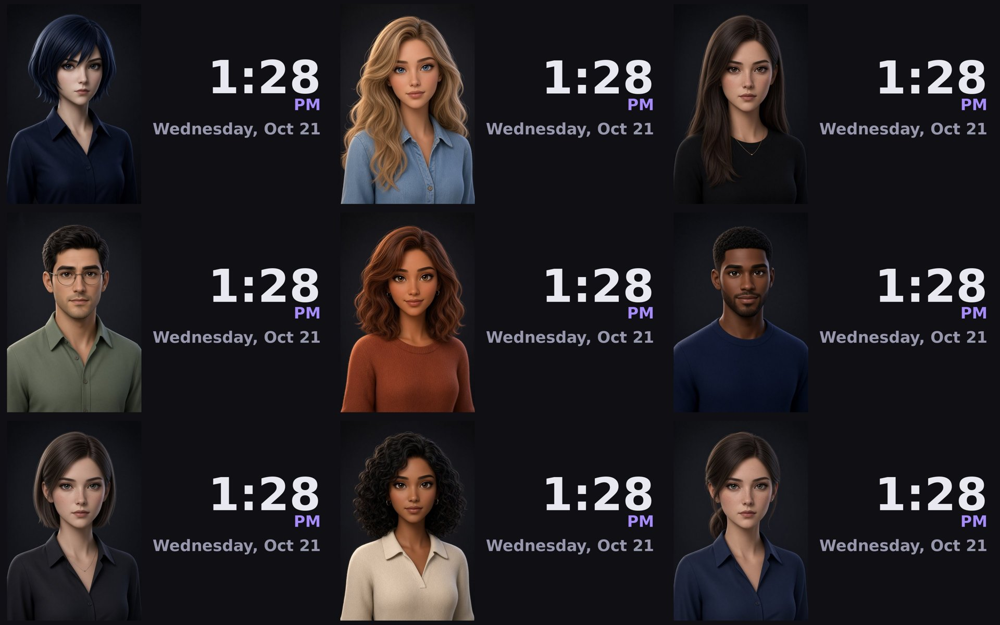

# House Ava

My own Alexa replacement for jailbroken Echo Shows. The Echoes run [TECHO5](https://github.com/HuskerMinion/techo5),
and one Python hub on a box in my house does the rest: listening, a local AI brain, her voice, the lights, music
from my NAS, intercom between rooms, routines and her face on the screen. No Amazon, no Home Assistant, and no
cloud account.

I've been building it the last couple of weeks and running it on two Echo Shows (the Show 5 since Oct 10, the
Show 8 since Oct 15), and it's been solid, so I'm putting it up for anyone who wants to try it, poke holes in it, or
help out.

<table>
<tr>
<td width="62%"></td>
<td width="38%"></td>
</tr>
<tr>
<td>Echo Show 8 (1st gen), grabbed straight off the screen</td>
<td>Echo Show 5 (1st gen)</td>
</tr>
</table>

> **Want to try it?** The **[step-by-step install tutorial](INSTALL.md)** takes you from a blank Linux box to
> "Alexa, turn off the lights", with a check after every step.
>
> **Heads up:** this is a hobby project for my own house that I'm sharing. It works great for me, but it's only
> been run on my two Echoes so far. If you try it, I'd love to hear how it goes (see [Help me out](#help-me-out)).

---

## What she can do

**Talk to her like Alexa.** Say "Alexa" (the wake word runs on the Echo itself, through TECHO5), then talk.
- Questions go to a local model on my GPU (Ollama, qwen2.5:14b). Anything that needs current info gets a web
  search first (your own SearXNG, then Wikipedia, Google News and DuckDuckGo).
- Three personalities: **sassy** (the default), **warm** or **deadpan**. Swearing and adult jokes are both
  switches, off by default.
- She remembers stuff you tell her ("remember my car is in spot 14") and forgets it when you ask.
- She knows the last few lines of what was said in that room, so follow-ups make sense.
- Time, date, timers and weather are answered instantly with no model involved. The weather does today, tomorrow,
  any day of the week, the weekend, or the whole week ("give me a seven-day forecast"), for home or another town
  ("what's the weather in Chicago").
- She tunes out the room. Whisper's made-up words ("Thanks for watching!") get thrown out, and if you turn on
  follow-up listening, chatter she hears after a reply that wasn't meant for her gets ignored.

**Lights (WiZ bulbs, local, so they work with the internet down).**
- "turn off the lights" works on the room the Echo is in. You can also say "the living room and dining room",
  "everything but the bedroom" or "bedroom light two".
- Brightness, colors, "for 10 minutes", "in 5 minutes", "turn it back on", and "are the lights on in here?"
- The parser was built to handle the stuff whisper mishears in real life. It's tested against about 39,000
  generated light commands and 1,157 sneaky ones.

**Music from your own library (NAS over SMB).**
- "play some Eminem", "play Lose Yourself", "play the album …", "play something chill", "skip", "stop",
  "skip this artist", "what's playing".
- It plays on the Echo that heard you, or the room you name. Each Echo has its own queue.
- MP3 and FLAC, never transcoded. The Echo plays both natively.

**Between rooms.**
- **Announce**: "announce dinner's ready", or "tell the kitchen I'm on my way".
- **Walkie-talkie intercom**: "intercom the bedroom". You talk, and it plays in the other room in your own voice.
  "reply …" goes back to whoever last intercommed or announced to you.
- **Live calls** using TECHO5's own two-way intercom: "call the kitchen" and do not disturb by voice. You answer
  and hang up on the Echo's screen or in the app (an Echo on a call doesn't listen for its wake word).
  Announcements wait while a call is on.

**Around the house.**
- **Routines**, Alexa style, made in the phone app. They start from a phrase, a time, sunrise/sunset, someone walking
  in (the Echo's presence sensor) or a tap on Run in the app. They can do lights, plugs, music, volume, say
  something, weather, wait, arm the house, and anything you'd say to her out loud.
- **Arm the house**: after an exit delay, any presence an Echo sees gets logged, pushed to your phone (ntfy) and
  announced.
- **Intruder alert**: "intruder alert" turns every light red at full brightness and blasts a song or genre you pick.
  A press of a volume button kills the music, and "all clear" puts the lights back how they were.
- **Hubspace plugs** (cloud, experimental. The code's there but I've never run it against a real plug).

**The Echo itself.**
- **Her face and a clock on the screen**, streamed from the hub and sized to each screen. Nine faces come with it, or
  use any picture you want (see [Faces and voices](docs/FACES-AND-VOICES.md)).
- "pair my phone" pairs your phone over Bluetooth so the Echo's a speaker, and "connect my phone" brings back one
  that's already paired.
- "stop listening for an hour" (it comes back by itself, even after a restart), "turn your mic up", and "you keep
  waking up" (tunes the wake word for just that Echo).
- Volume, bass/treble, mic gain, echo canceller, follow-up listening and so on get set on every Echo each time it
  connects, so one config covers the whole house.

**For fun.**
- Jokes that don't repeat until she's told the whole bank (176 regular, plus 84 dirty, 68 adult and 50 morbid once
  you turn adult jokes on).
- Call her names and she fires back, from a bank of about 1,000 comebacks or a fresh roast. With swearing off she
  keeps it clean.
- "roast Jordan", "roast me", "roast yourself", plus "another one" and "longer".

**A phone app** (any browser, port 8792, PIN protected): chat with her by typing, see what each Echo heard and what
she said back, change settings, add Echoes, make routines, pair Bluetooth, and place calls.

---

## Her faces



Ava, Brooke, Claire, Elias, Harper, Jordan, Lena, Maya and Reese, each one drawn the way the hub streams it to a
Show 8. Pick one in the app (Settings → Screen) or point it at your own picture: a photo, your dog, a logo, a PNG
with a see-through background, whatever. It switches within a second. More screenshots and how to make your own
face pack: **[docs/FACES-AND-VOICES.md](docs/FACES-AND-VOICES.md)**.

---

## What I run it on

| Part | My setup |
|---|---|
| Echo #1 | **Echo Show 5, 1st gen** (`checkers`, 960×480), TECHO5 1.4.0 |
| Echo #2 | **Echo Show 8, 1st gen** (`crown`, 1280×800), TECHO5 1.4.0. Way louder than the Show 5 |
| Server | A Proxmox VE 9.2 box: Xeon E5-2699 v4 (22 cores / 44 threads), 64 GB RAM |
| The VM | Debian 13, 4 vCPU, 14 GB RAM + 4 GB swap, on its own SSD |
| GPU | NVIDIA RTX A2000 12 GB, passed straight through to the VM (driver 550.163.01) |
| Brain | Ollama 0.40.5 with `qwen2.5:14b` (about 9 GB of VRAM, kept loaded) |
| Speech to text | faster-whisper 1.2.1, `large-v3-turbo` on the GPU (int8_float16, about 1 GB of VRAM) |
| Voice | edge-tts 7.3.1 (Microsoft's neural voices) with Kokoro-82M as the offline backup |
| Search | SearXNG in Docker on the same VM |
| Python | 3.13.5, aioesphomeapi 46.9.0 |
| Lights | 6 WiZ bulbs, 2 per room |
| Music | A TrueNAS SMB share mounted read-only, about 254k tracks |

Before I moved it onto the Proxmox box it ran bare metal on an old HP ProDesk office PC (i5-7500, 20 GB) with the
same A2000, and that was plenty.

**What you'd need:**
- At least one Echo running TECHO5. I've only tried the Show 5 and Show 8 1st gens. TECHO5 runs on more (Show 5
  2nd gen, Show 8 2nd gen, Spot, Dot 2…) and House Ava *should* work on them, but I haven't tested that. If you
  have one, please tell me!
- An always-on 64-bit Linux box or VM with Python 3.11+, on the same network as the Echoes.
- For the full experience, an NVIDIA GPU with **12 GB of VRAM**. The 14B model plus whisper fits right in. With a
  smaller card, use a 7B or 8B model and whisper `small.en` on the CPU (that's the default). With no GPU at all it
  works, but the brain gets slow. Everything that doesn't need the brain (lights, time, timers, intercom, routines
  and most music requests) stays fast.

---

## How it works (the short version)

```
 Echo (TECHO5)                                   House Ava hub (one Python process)
 ─────────────                                   ──────────────────────────────────
 "Alexa" wake word ──audio over the ESPHome API──▶ whisper (speech to text)
   runs on the Echo                                  │
                                                     ▼
                                              fast paths: lights, music, time, timers, intercom,
                                              routines, jokes …  (no model, instant)
                                                     │ nothing matched
                                                     ▼
                                              Ollama: what do they want? → answer / search / action
                                                     │
 speaker  ◀──── fetches the reply WAV (:8790) ─── edge-tts (Kokoro if offline)
 screen   ◀──── face + clock stream (:8793) ────── facecast
 speaker  ◀──── songs (:8791) ──────────────────── music library on your NAS
```

The hub is the Echo's one ESPHome API client (the same connection Home Assistant would use), so TECHO5 handles the
wake word, mics, speaker and screen, and House Ava handles everything else. The full walkthrough is in
**[docs/HOW-IT-WORKS.md](docs/HOW-IT-WORKS.md)**.

---

## Getting started

**New to this? Follow [INSTALL.md](INSTALL.md)**: every command, what you should see after each step, and a test
checklist at the end. Every option is in [docs/SETUP.md](docs/SETUP.md). The short version, if you've done this kind
of thing before:

1. Flash your Echo with [TECHO5](https://github.com/HuskerMinion/techo5) and keep the API key the installer gives you.
2. On a Linux box: install Ollama, pull a model, and `sudo apt install git curl python3-venv fonts-dejavu-core libnss-mdns`.
3. `sudo loginctl enable-linger $USER` (so it runs from boot), then
   `git clone https://github.com/chaoticdopey/house-ava ~/house-ava && cd ~/house-ava && bash deploy/install-houseava.sh`
4. Add your Echo:
   `cd ~/houseava && HOUSEAVA_DIR=~/.houseava .venv/bin/python -m houseava.satellite add --name "Kitchen Echo" --ip kitchen-echo.local --room kitchen --psk '<key>'`
5. Find your bulbs with `cd ~/houseava && .venv/bin/python -m houseava.find_bulbs`, add them (and your
   `location`) to `~/.houseava/houseava_config.json` with the hub stopped (edit the file the add command made,
   don't replace it: your Echo's in there), then run `systemctl --user start houseava`
6. Open `http://<your server>:8792` on your phone. The PIN is made on the first start:
   `grep '"pin"' ~/.houseava/houseava_config.json`

Then: "Alexa, turn off the lights."

---

## What's tested

Seventeen test suites, all passing on a clean install (Debian 13, Python 3.13). There's more on what each one covers,
plus everything I've tried on the real Echoes, in **[docs/TESTING.md](docs/TESTING.md)**. A few things still haven't
been tested for real: Hubspace plugs, a full live call between the two Echoes, arm-the-house from a real walk-in,
and anything that isn't a Show 5 / Show 8 1st gen.

What changed along the way is in **[CHANGELOG.md](CHANGELOG.md)**.

---

## Privacy and safety defaults

- Nothing goes to Amazon. Speech to text and the brain run on your box.
- The things that use the internet: Microsoft's voice (edge-tts), web search fallbacks, weather (Open-Meteo, plus
  ip-api.com to guess where you are if you don't set a location or city), phone pushes (ntfy.sh) and Hubspace. The first start also
  downloads the whisper model. After that, lights, brain, speech to text and the offline voice all keep working
  without the internet.
- Recording voice turns for tuning (`stt.keep_audio`) is **off** by default. The text of what was said and her
  replies does get kept: in `~/.houseava/conversations.jsonl` (the app's Conversations tab, never trimmed) and in the
  service log.
- The app is plain HTTP with a PIN. A random 6-digit one is made on first run, and wrong guesses get slowed
  down. **Don't port-forward it to the internet.**
- Swearing and adult jokes are **off** by default. Turn them on in the app if that's your house.

---

## Help me out

This is what I'd love from anyone who tries it:
- **Test reports**: what Echo, what server and GPU, what worked and what didn't. There's an issue template for it.
- **Ideas and questions**: head over to **[Discussions](https://github.com/chaoticdopey/house-ava/discussions)**.
- **Code**: PRs are welcome. Read [CONTRIBUTING.md](CONTRIBUTING.md) first; it's short.

Some stuff I'd really like help with: other Echo models, other languages (it's English only right now), a smaller
GPU setup, the mouth moving while she talks (the frames are already in the face packs), and voice ID (enrolling
works, but nothing uses it yet).

## Thanks

- The music library in `vendor/ava` and a few pieces of the brain came over from Ava, my desktop assistant (that
  one isn't public).
- **[TECHO5](https://github.com/HuskerMinion/techo5)** by HuskerMinion. None of this works without it. Go star it.
- [faster-whisper](https://github.com/SYSTRAN/faster-whisper), [Ollama](https://ollama.com),
  [edge-tts](https://github.com/rany2/edge-tts), [Kokoro](https://github.com/thewh1teagle/kokoro-onnx),
  [aioesphomeapi](https://github.com/esphome/aioesphomeapi), [SearXNG](https://github.com/searxng/searxng),
  [Open-Meteo](https://open-meteo.com) and [mutagen](https://github.com/quodlibet/mutagen).

## License

MIT, see [LICENSE](LICENSE). This is a fan project and has nothing to do with Amazon. "Alexa" and "Echo" are
Amazon's trademarks.
